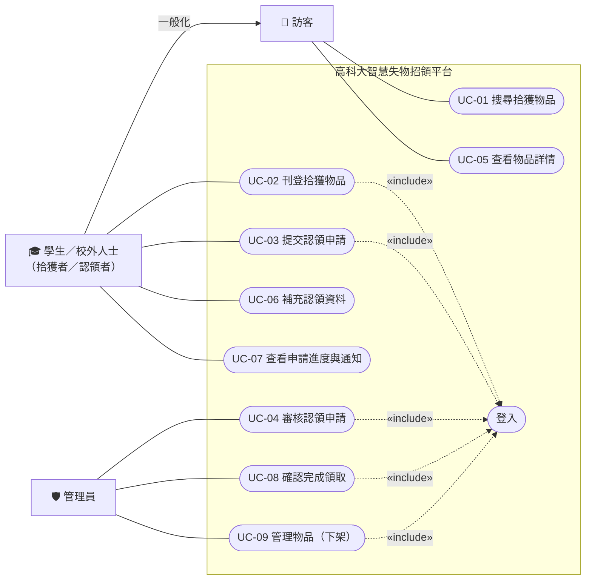

# 作業 3：需求分析與使用案例

專題：高科大智慧失物招領平台（課堂展示原型）

## 一、系統角色

| 角色 | 說明 |
|---|---|
| 訪客 | 未登入的一般使用者，可瀏覽、搜尋、查看公開資訊 |
| 學生（含校外人士） | 以示範帳號登入；高科大師生與校外人士權限相同，同一人可以是「拾獲者」或「認領者」。校外人士沒有學號，認領時學號免填 |
| 管理員 | 可查看非公開驗證資訊、審核認領、確認領取、管理物品 |

## 二、功能性需求

| 編號 | 需求 | 說明 | 對應頁面／程式 |
|---|---|---|---|
| FR-01 | 首頁 | 顯示平台名稱與介紹、最新 6 筆拾獲物品、搜尋入口、「瀏覽失物」與「刊登拾獲物品」入口 | `index.html`、`getLatestPublicItems` |
| FR-02 | 失物列表 | 以卡片顯示公開刊登的物品，點選卡片進入詳情；已下架物品不顯示 | `items.html`、`listPublicItems` |
| FR-03 | 物品搜尋 | 依名稱、類別、關鍵字、校區搜尋；只比對公開欄位 | `searchPublicItems` |
| FR-04 | 物品分類 | 3C 產品、錢包、證件、衣物及配件、書籍及文具、鑰匙、其他 | `CATEGORIES` |
| FR-05 | 物品詳情 | 只顯示名稱、類別、顏色、日期、大致地點、公開描述、外觀照片、公開狀態、「我要認領」 | `item.html`、`toPublicItem`、`derivePublicStatus` |
| FR-06 | 刊登拾獲物品 | 學生或校外人士登入後（物品必須在高科大校內拾獲，校區限高科大 5 個校區）填寫公開資訊與非公開驗證資訊；擋下公開欄位中的個資；敏感類別預設不上傳照片 | `post.html`、`validateItemForm`、`createItem` |
| FR-07 | 認領申請 | 學生或校外人士登入後填寫姓名、學號（模擬，校外人士免填）、聯絡方式、特徵描述、其他證明；必填未完成不可送出；不提供選擇題 | `claim.html`、`validateClaimForm`、`createClaim` |
| FR-08 | 管理員審核 | 查看所有申請、比對申請描述與驗證特徵、核准、拒絕、要求補充、下架物品 | `admin.html`、`transition`、`getItemSecret` |
| FR-09 | 認領狀態 | 待審核、需要補充資料、審核通過、審核未通過、已完成領取；審核通過後需現場核對才可完成 | `CLAIM_STATUS`、`ACTIONS` |
| FR-10 | 通知訊息 | 申請送出、要求補充、審核通過、審核未通過、完成領取時產生站內通知 | `my.html`、`notifications.js` |

## 三、非功能性需求

| 編號 | 類別 | 需求 |
|---|---|---|
| NFR-01 | 隱私與安全 | 非公開驗證資訊與公開資料分開存放；公開頁面與搜尋不得讀取驗證資訊；所有使用者輸入輸出前需轉義以防 XSS；不蒐集不必要個資、不要求上傳證件 |
| NFR-02 | 易用性 | 介面使用繁體中文；表單標示必填星號、欄位下方顯示錯誤訊息；重要操作以提示訊息回饋成功或失敗；重要操作前需確認 |
| NFR-03 | 響應式設計 | 支援 360px 手機到 1280px 以上桌機，手機使用漢堡選單，不出現水平捲軸 |
| NFR-04 | 效能 | 列表與搜尋在 1 秒內顯示；照片於上傳前壓縮至最長邊 800px、500KB 以內 |
| NFR-05 | 可維護性 | 邏輯模組不直接操作畫面，可在 Node 中自動測試；檔案依功能分層 |
| NFR-06 | 原型限制 | 全站標示「課堂展示原型」，說明 localStorage 與模擬登入不具正式保護；正式上線需改用伺服器端驗證、權限控管與安全儲存 |

## 四、使用案例圖

> Mermaid 沒有原生使用案例圖語法，以下用 flowchart 表示：方框外為角色，大框為系統邊界，圓角為使用案例，虛線為 «include»。

學生繼承訪客的所有使用案例（搜尋、查看詳情）。

## 五、詳細使用案例

### UC-01 搜尋拾獲物品

| 項目 | 內容 |
|---|---|
| 主要角色 | 訪客（含學生、管理員） |
| 目標 | 找到可能是自己遺失的物品 |
| 前置條件 | 無，不需要登入 |
| 對應需求 | FR-01、FR-02、FR-03、FR-04 |

**主要流程**

1. 使用者在首頁搜尋框輸入關鍵字，或點選類別入口。
2. 系統開啟失物列表，帶入搜尋條件。
3. 使用者可再選擇類別與校區。
4. 系統只比對公開欄位（名稱、類別、顏色、校區、地點、公開描述），排除已下架物品，依拾獲日期由新到舊顯示卡片與結果筆數。
5. 使用者點選卡片，進入物品詳情（UC-05）。

**替代流程**

- 4a. 沒有符合的物品：系統顯示「找不到符合條件的物品」與建議。
- 4b. 關鍵字剛好是某物品的非公開特徵：系統不比對驗證資訊，結果為 0 筆。

**後置條件**：顯示符合條件的公開物品清單，不洩漏任何驗證資訊。

### UC-02 刊登拾獲物品

| 項目 | 內容 |
|---|---|
| 主要角色 | 學生或校外人士（拾獲者） |
| 目標 | 刊登拾獲物品，讓失主可以找到 |
| 前置條件 | 已登入學生或校外人士帳號（«include» 登入）；物品是在高科大校內拾獲 |
| 對應需求 | FR-06 |

**主要流程**

1. 拾獲者點選「刊登拾獲物品」。
2. 系統顯示表單，分為「🌐 公開資訊」與「🔒 僅管理員可見」兩區。
3. 拾獲者填寫公開資訊：名稱、類別、顏色、校區、大致地點、拾獲日期、簡短描述（50 字內），可選擇上傳外觀照片。
4. 拾獲者填寫至少一項非公開驗證特徵：特殊標記、內部物品、其他特徵。
5. 拾獲者送出。
6. 系統驗證欄位，把公開資訊存入 `lf_items`，驗證特徵存入 `lf_secrets`。
7. 系統顯示成功訊息並開啟物品詳情頁。

**替代與例外流程**

- 1a. 未登入：系統導向登入頁，登入後回到刊登頁。
- 3a. 選擇證件、錢包或 3C 產品：系統顯示敏感照片警告並停用上傳，需勾選確認才可上傳。
- 3b. 圖片格式錯誤或壓縮後超過 500KB：系統顯示錯誤，不保存照片。
- 6a. 必填欄位未填、描述超過 50 字、日期為未來：系統在欄位下方顯示錯誤，不儲存。
- 6b. 公開欄位含 6 位以上連續數字、Email 或手機號碼：系統擋下並說明原因。
- 6c. 未填任何驗證特徵：系統要求至少填寫一項。

**後置條件**：新物品出現在公開列表，狀態為「待認領」；驗證特徵只有管理員看得到。

### UC-03 提交認領申請

| 項目 | 內容 |
|---|---|
| 主要角色 | 學生或校外人士（認領者） |
| 目標 | 對自己遺失的物品提出認領 |
| 前置條件 | 已登入學生或校外人士帳號；物品未下架、未領回；不是自己刊登的物品；沒有對同一物品進行中的申請 |
| 對應需求 | FR-07、FR-09、FR-10 |

**主要流程**

1. 認領者在物品詳情點選「我要認領」。
2. 系統檢查認領資格，顯示申請表單，只附上物品的公開資訊。
3. 系統帶入姓名與模擬學號，認領者可修改；校外人士學號免填。
4. 認領者填寫聯絡方式、自行描述物品特徵（至少 15 字）、其他證明資訊（選填），並勾選同意現場核對。
5. 認領者送出。
6. 系統建立狀態為「待審核」的申請，記錄歷程，產生「認領申請已送出」通知。
7. 系統顯示「認領申請已送出，等待管理員審核」，並說明送出不代表認領成功。

**替代與例外流程**

- 1a. 未登入：導向登入頁，登入後回到申請表單。
- 2a. 自己刊登的物品、已領回、已下架、重複申請、管理員帳號：系統說明原因，不顯示表單。
- 5a. 必填欄位未完成或描述不足 15 字：系統顯示錯誤，不送出。

**後置條件**：申請狀態為「待審核」，物品公開狀態變為「認領處理中」。

### UC-04 審核認領申請

| 項目 | 內容 |
|---|---|
| 主要角色 | 管理員 |
| 次要角色 | 學生或校外人士（認領者，接收通知） |
| 目標 | 判斷申請人是否為真正失主 |
| 前置條件 | 已登入管理員帳號；有待審核的申請 |
| 對應需求 | FR-08、FR-09、FR-10 |

**主要流程**

1. 管理員開啟審核後台，系統列出待審核申請與各狀態筆數。
2. 管理員選擇一筆申請。
3. 系統並排顯示申請人描述與拾獲者登記的非公開驗證特徵，以及處理歷程。
4. 管理員比對兩邊資料，選擇「核准」。
5. 系統將狀態改為「審核通過」，記錄歷程，通知申請人攜帶學生證（校外人士為附照片的身分證件）到現場。
6. 申請人到場後，管理員核對學生證或附照片的身分證件與物品特徵，勾選「已現場核對身分與物品」並按「確認完成領取」。
7. 系統將狀態改為「已完成領取」，物品公開狀態變為「已領回」，通知申請人；同物品其他進行中的申請自動改為「審核未通過」並通知。

**替代與例外流程**

- 4a. 資料不足：管理員填寫說明並選擇「要求補充資料」，狀態變為「需要補充資料」並通知申請人；申請人補充後回到「待審核」（UC-06）。
- 4b. 描述不符：管理員填寫理由並選擇「拒絕」，狀態變為「審核未通過」並通知申請人。
- 4c. 拒絕或要求補充未填說明：系統顯示錯誤，不變更狀態。
- 4d. 同物品已有另一筆審核通過的申請：系統拒絕核准。
- 6a. 未勾選現場核對：「確認完成領取」按鈕停用。
- 6b. 現場核對不符：管理員填寫理由，將申請改為「審核未通過」。
- 1a. 非管理員開啟後台：系統顯示「權限不足」。

**後置條件**：申請進入新狀態並留下歷程；申請人收到對應通知。
