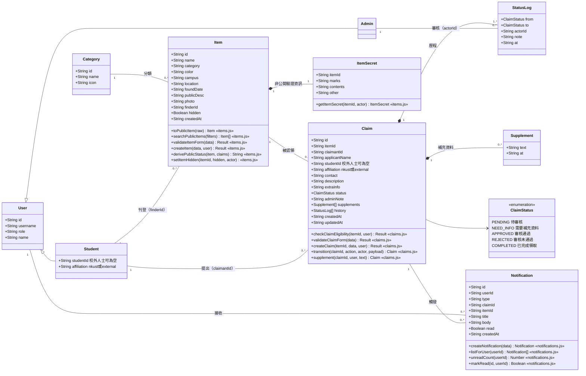
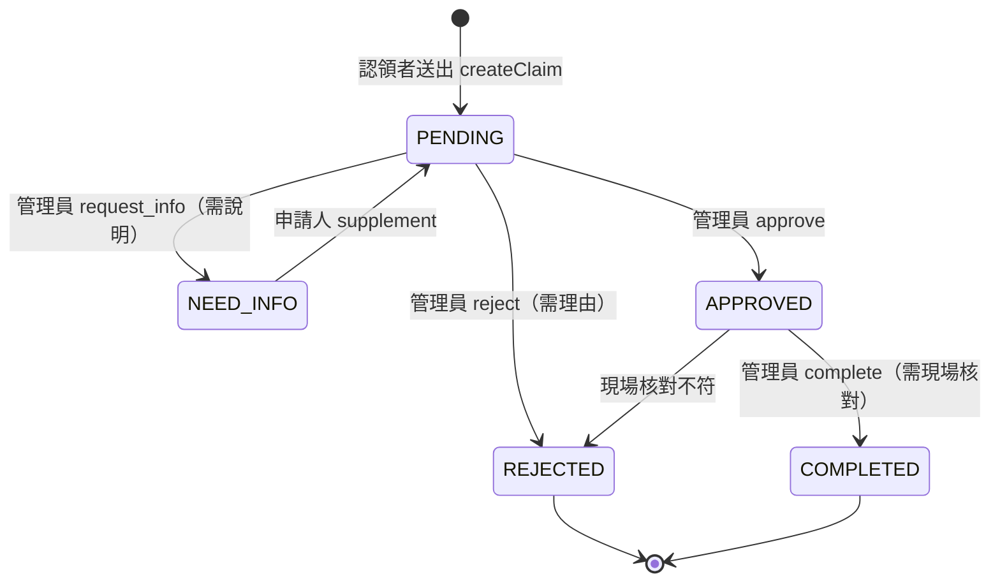
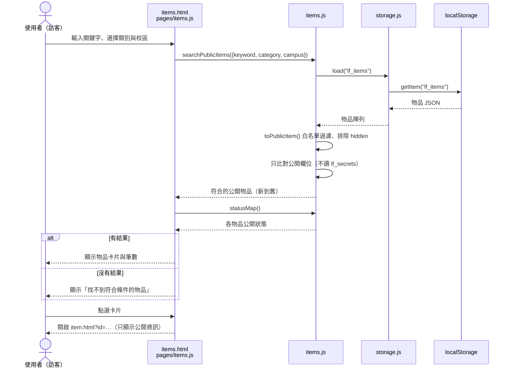
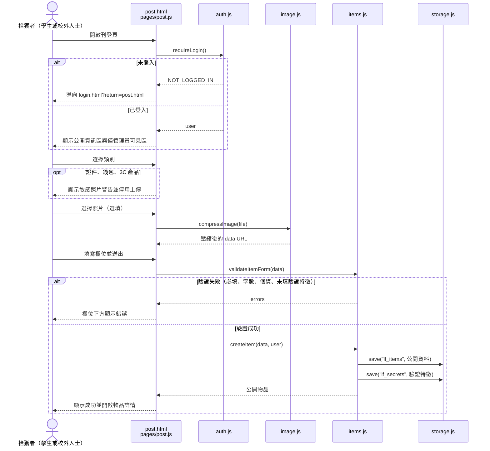
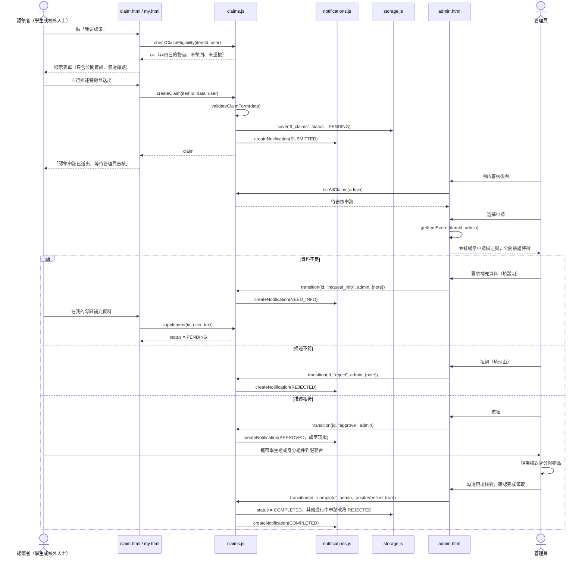
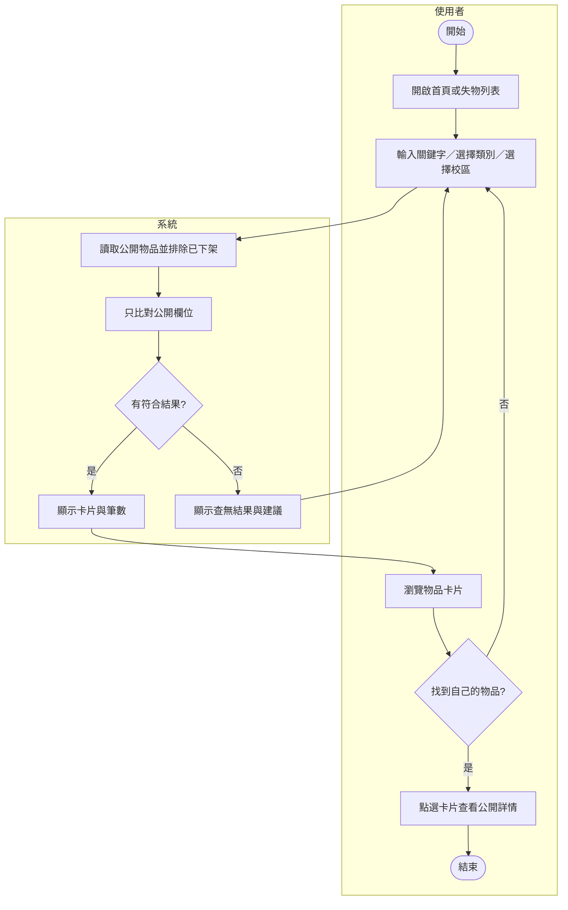
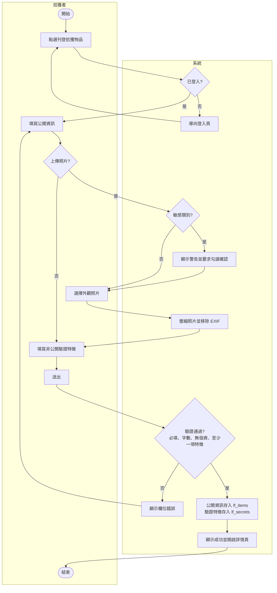
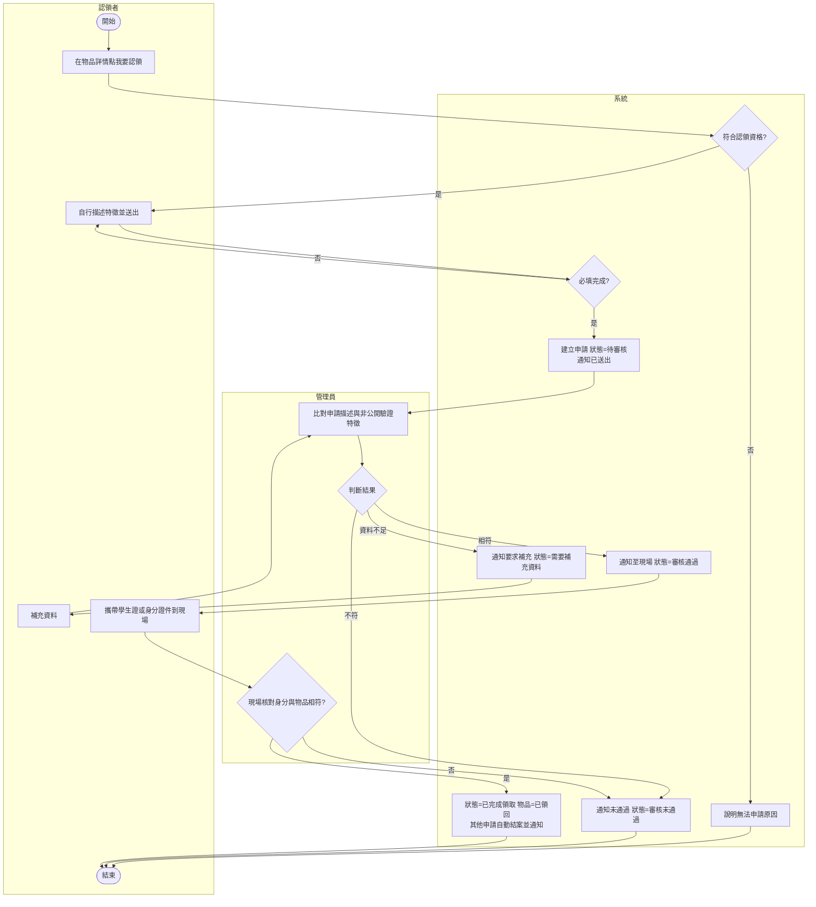

# 作業 4：UML 設計

專題：高科大智慧失物招領平台（課堂展示原型）

本文件的類別、屬性與方法名稱與網站程式（`js/` 資料夾）一致。原型以 JavaScript 模組實作，類別圖中的方法對應模組匯出的函式，括號內註明所在檔案。

## 一、UML 類別圖

設計重點：

- `Item` 與 `ItemSecret` 分開存放（`lf_items`、`lf_secrets`）。公開頁面只能透過 `toPublicItem()` 取得白名單欄位，`getItemSecret()` 要求 `actor.role === "admin"`。
- `Claim.status` 只能透過 `transition()`（管理員）與 `supplement()`（申請人，只限 NEED_INFO → PENDING）改變，每次都新增一筆 `StatusLog`。

### 認領狀態圖（補充）

## 二、循序圖

### UC-01 搜尋拾獲物品

### UC-02 刊登拾獲物品

### UC-03 提交及審核認領申請

## 三、活動圖

> Mermaid 沒有原生活動圖語法，以下用 flowchart 表示：圓角為開始／結束，方框為活動，菱形為判斷，子框為泳道。

### UC-01 搜尋拾獲物品

### UC-02 刊登拾獲物品

### UC-03 提交及審核認領申請

## 四、需求、使用案例、圖表與程式對照

| 功能需求 | 使用案例 | 循序圖／活動圖 | 主要程式 | 自動測試 |
|---|---|---|---|---|
| FR-01 首頁 | UC-01 | UC-01 | `index.html`、`pages/home.js` | `items.test.js` 最新物品 |
| FR-02 失物列表 | UC-01 | UC-01 | `items.html`、`listPublicItems` | `items.test.js` 下架 |
| FR-03 搜尋 | UC-01 | UC-01 | `searchPublicItems` | `items.test.js` 隱藏特徵搜尋 |
| FR-04 分類 | UC-01、UC-02 | UC-01、UC-02 | `CATEGORIES` | `items.test.js` 類別篩選 |
| FR-05 物品詳情 | UC-05 | UC-01 | `item.html`、`toPublicItem`、`derivePublicStatus` | `items.test.js` 白名單、公開狀態 |
| FR-06 刊登 | UC-02 | UC-02 | `post.html`、`validateItemForm`、`createItem`、`image.js` | `items.test.js` 刊登驗證 |
| FR-07 認領申請 | UC-03 | UC-03 | `claim.html`、`createClaim` | `claims.test.js` 資格與驗證 |
| FR-08 管理員審核 | UC-04、UC-09 | UC-03 | `admin.html`、`transition`、`getItemSecret` | `claims.test.js` 權限與轉換 |
| FR-09 認領狀態 | UC-04、UC-06、UC-08 | UC-03、狀態圖 | `CLAIM_STATUS`、`ACTIONS`、`supplement` | `claims.test.js` 狀態機 |
| FR-10 通知 | UC-07 | UC-03 | `my.html`、`notifications.js` | `notifications.test.js` |
